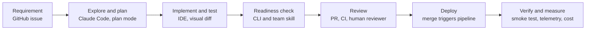
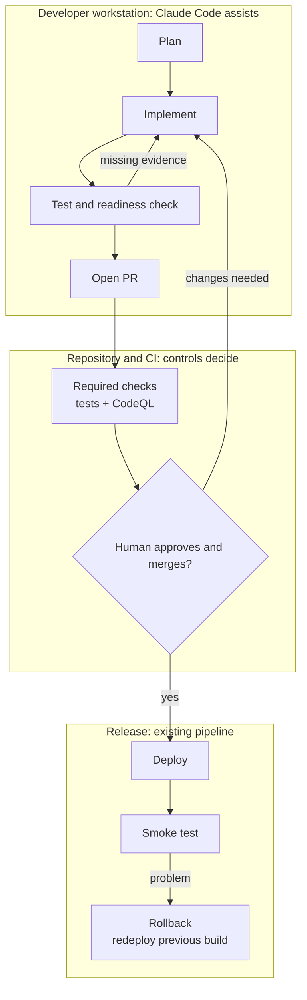

# FinTechCo × Claude Code

## What we've heard

**Environment**
- Digital payments and traditional banking on AWS and GCP.
- 180 technical staff:

  | Team | Size | Work | Stack |
  |---|---:|---|---|
  | Software engineering | 120 | Payments, mobile, banking infrastructure | Python, TypeScript, Java |
  | Data science | 40 | Fraud, credit, customer behavior | Python, Jupyter, pandas, scikit-learn, TensorFlow |
  | SRE | 20 | Incidents and reliability | Python, shell, Go |

**Current workflow**
- No agentic coding tools in use today.
- Evaluating Claude Code alongside other assistants, including GitHub Copilot and Devin.

**Requirements**
- Works inside existing IDEs, terminals, Git, CI and release processes.
- Security and compliance boundaries: identity, permissions, data handling, auditability.
- Visibility into cost, usage and what the agent did.

**Objective:** choose one company-wide agentic coding tool within the next few months.

**Success means:** engineering ships accepted changes with less effort, without more rework, release failures or unacceptable cost.

## What we'll walk through

**Today's feature:** customers can choose which month their Spending insights page shows. We'll look at the finished result first, then build it from the requirement up.

## Where Claude Code sits, and where it doesn't

Claude prepares, implements and analyzes. Permissions, required checks, scoped credentials and people decide what ships.

## Secure code in three layers

| Layer | What | Why |
|---|---|---|
| Built into how Claude writes | CLAUDE.md security rules, the readiness skill's checklist, and a write-time guard hook | Correct the first time: no tokens spent fixing what shouldn't have been written |
| Governance Claude can't override | Required CodeQL and test checks, secret scanning with push protection, deny rules, CODEOWNERS | The platform decides what merges, not the agent |
| Independent analysis | CodeQL: a deterministic engine, separate from the model that wrote the code | A second reference point that doesn't share Claude's blind spots |

## Recap: what we saw today

- One requirement taken from issue to production in the developer's own tools.
- Evidence at every step: tests, readiness table, CI run, deploy, smoke test, telemetry (actions, decisions, cost).
- Controls held: push needed approval, merge was denied to Claude, and release needed a human.
- Next step: a pilot with named repositories, owners, representative tasks and agreed thresholds.
